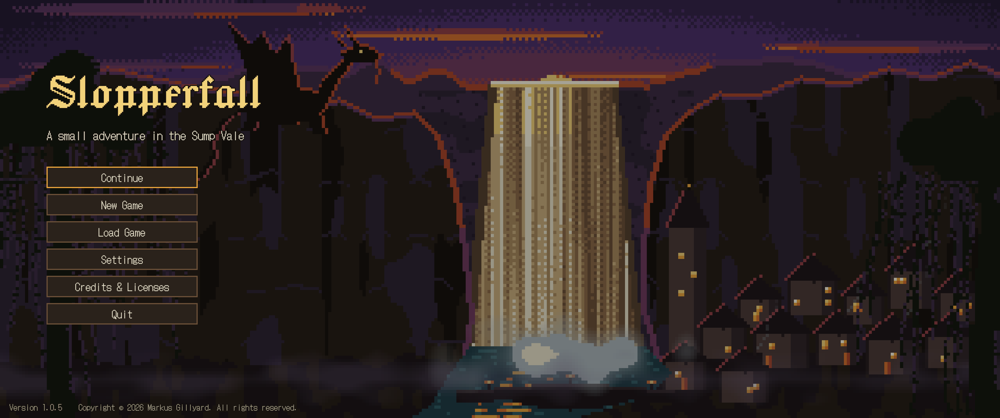
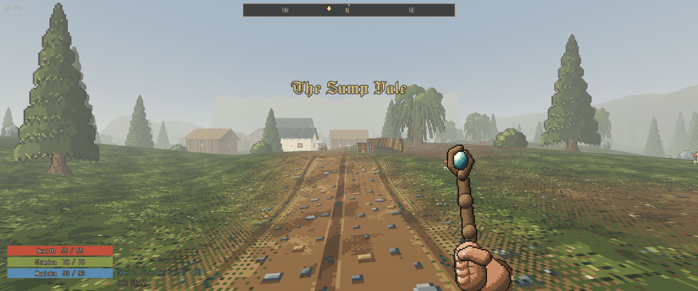
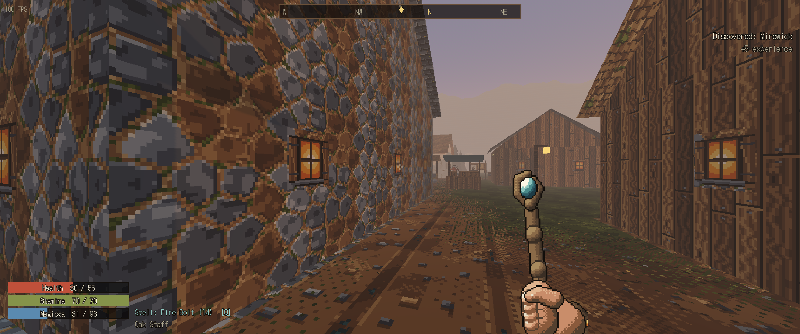
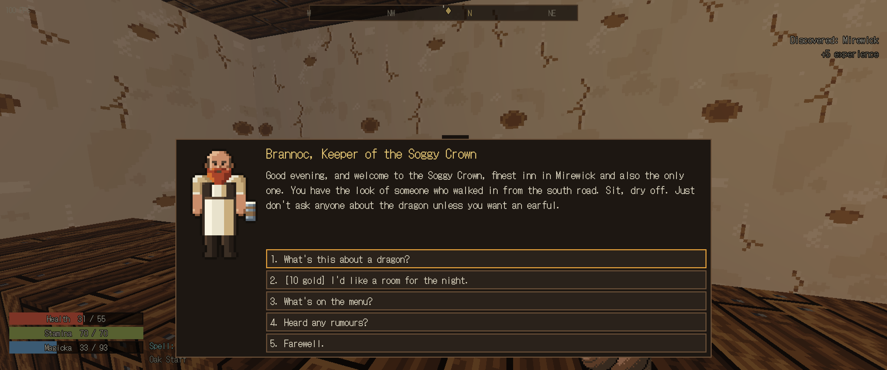
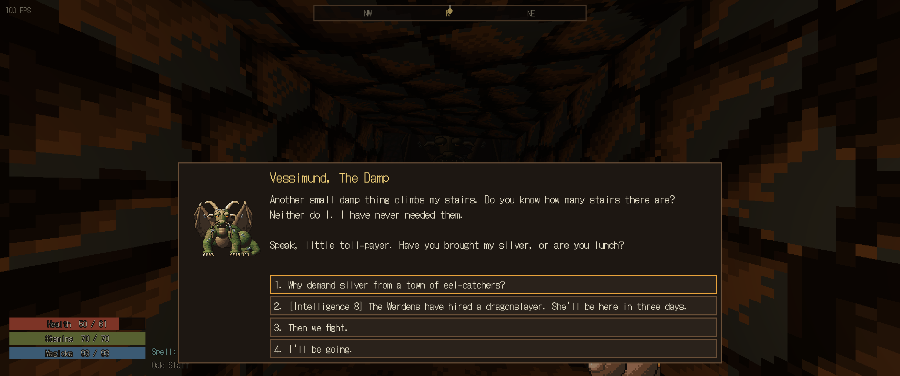
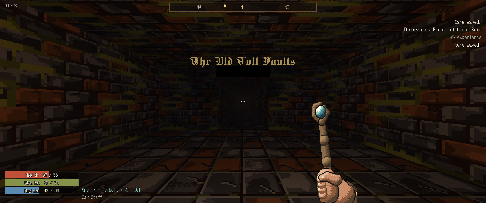
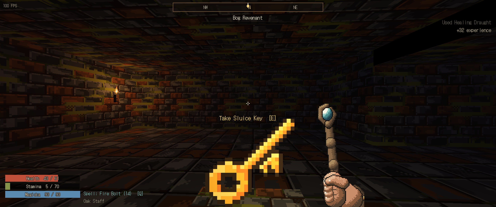

# Slopperfall

**A miniature first-person fantasy RPG for Linux.**

Slopperfall is a game I, Markus Gillyard, made for fun using Claude, Anthropic's AI. I directed
it, played it and decided what went in; Claude wrote the code and generated the art, sound and
music with the project's own tools.

You arrive in **Mirewick**, a muddy toll-town at the foot of a colossal waterfall, just as
**Vessimund the Damp**, an old, vain and clever dragon, demands a hundredweight of silver. The
Toll Wardens want him dead, the Mudlarks want to pay him off, and nobody has asked the dragon what
he actually wants.

Explore the Sump Vale, fight through procedurally generated dungeons, take contracts from rival
factions, and settle the matter by sword, silver or wit. People remember what you chose.

It is small on purpose: one valley, one town, four dungeons and one dragon, playable in an
afternoon, with a chunky retro pixel look.

**[Download the latest version](https://github.com/MarkusGillyard/Slopperfall-releases/releases/latest)**: free, for Linux x86_64.



| | |
|---|---|
|  |  |
|  |  |
|  |  |

## What is in it

- **An explorable vale** around the town of Mirewick and the great falls, with a marsh, ruins, standing stones, a reaver camp, a day/night cycle and places to discover.
- **People and factions:** a dozen characters with reactive, hand-written dialogue, and two factions whose opinion of you changes prices, services, work and rewards.
- **Quests:** a branching main quest with three distinct endings, a bounty, and generated contracts. A journal, compass markers and a map keep track of it all.
- **Procedural dungeons:** caves behind the falls, crypt vaults, a flooded chapel and the dragon's Roost, generated from your world's seed and remembered between visits.
- **Combat:** melee, bows and spells, blocking, sneak attacks, damage types and resistances, explosive marsh gas, and a dragon who scales with your level.
- **RPG systems:** three backgrounds, four attributes, levelling, equipment, merchants, a fence, healing and resting.
- **Saving:** autosave, quicksave and three slots.

## Installing

1. Download `Slopperfall-<version>-linux-x86_64.tar.gz` from the [releases page](https://github.com/MarkusGillyard/Slopperfall-releases/releases/latest).
2. Optionally check it against the `.sha256` file from the same page:

   ```bash
   sha256sum -c Slopperfall-1.0.7-linux-x86_64.tar.gz.sha256
   ```

3. Extract it and launch:

   ```bash
   tar -xzf Slopperfall-1.0.7-linux-x86_64.tar.gz
   ./Slopperfall-1.0.7-linux-x86_64/Slopperfall.sh
   ```

Nothing else needs installing. The game uses Vulkan and falls back to OpenGL 3 automatically
when Vulkan is unavailable; to force OpenGL, run `./Slopperfall.sh --rendering-driver opengl3`.
It has no network features and collects no data.

Saves and settings live in `~/.local/share/Slopperfall/`.

## Controls

Every key except Escape and the number keys can be rebound in **Settings → Controls**.

| Action | Default |
|---|---|
| Move | W A S D |
| Look | Mouse |
| Attack (hold to draw a bow) | Left mouse |
| Block | Right mouse |
| Cast readied spell | Q |
| Next spell / ready spell 1–4 | R / 1–4 |
| Swap melee weapon and bow | X |
| Drink best healing item | H |
| Interact, talk, loot | E |
| Jump / Sprint / Sneak | Space / Shift / Ctrl |
| Inventory / Journal / Map | I / J / M |
| Quicksave / Quickload | F5 / F9 |
| Pause | Escape |

Settings also cover mouse sensitivity, field of view, head bob, volume, window mode, VSync, a
frame-rate limit, interface scale and **pixel size**, which sets the retro look and doubles as a
performance option.

## Known limitations

- Linux x86_64 only. It has been tested on Linux Mint 22.3 with an NVIDIA GPU; other distributions, GPUs and Wayland sessions are untested.
- Living enemies in a dungeon return to full health at their posts when you reload a save made inside it. Kills, loot, opened chests and objectives are all kept.
- Townsfolk keep their posts day and night.

Found a bug? [Open an issue](https://github.com/MarkusGillyard/Slopperfall-releases/issues) and
say what you were doing, and if you can, which save slot it happened in.

## License

**Copyright © 2026 Markus Gillyard. All rights reserved.**

**Play it, record it, stream it.** Anyone may download the official builds from this page and
play them as much as they like. You're free to record, stream and screenshot your play and to
publish and monetise those videos anywhere, music included. A link back to this page is
appreciated but not required.

**Mods are welcome.** You may unpack the official builds, change your own copy, and share mods
for free. A mod may include changed game files where it needs them, but not the whole game or a
repackaged build, so players still get Slopperfall itself from this page. Mark mods as unofficial,
and don't imply they're endorsed. You own your own work in your mod. There's no built-in mod
loader yet: the game's data, written as JSON and GDScript, lives inside the executable's
embedded Godot pack.

Redistributing the game itself or selling it needs written permission. The full terms are in
[LICENSE.md](LICENSE.md).

The game is built with the Godot Engine (MIT) and uses the DotGothic16 and Jacquard 24 fonts
(SIL Open Font License 1.1). Their licenses ship inside every download, in
`THIRD_PARTY_NOTICES.md` and the `licenses/` folder.
